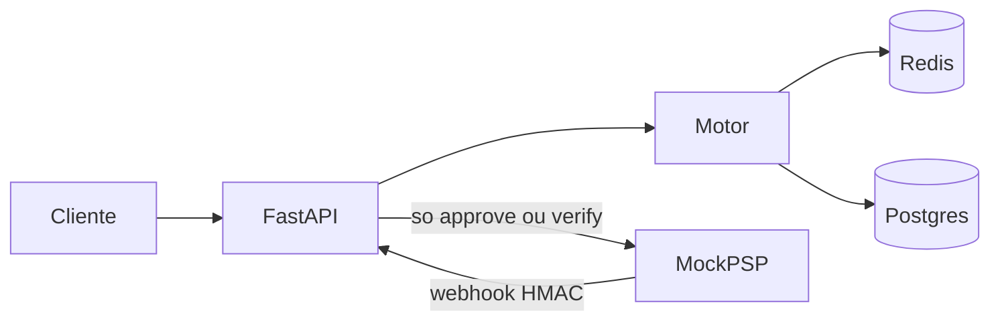

# Antifraude inline

Serviço que fica no meio do checkout. Cada tentativa recebe `approve`, `challenge` ou `deny` antes de o mock do PSP ser chamado. Só `approve` (e um `challenge` que passou no OTP) pede cobrança. O webhook que volta é tratado como entrada não confiável: HMAC, janela de tempo e id de evento.

Prazo combinado com o recrutador: entrega na segunda, 12/10/2026.

## Como ler o código

A ordem abaixo é a ordem do request.

1. [app/main.py](app/main.py) sobe Redis, Postgres, regras e o rate limit.
2. [app/api/payments.py](app/api/payments.py) é o fluxo: chave, fingerprint do cartão, reserva, score, PSP.
3. [app/engine/signals.py](app/engine/signals.py) separa o que o cliente afirma do que o socket observa.
4. [app/engine/scorer.py](app/engine/scorer.py) soma os pesos do [config/rules.yml](config/rules.yml).
5. [app/storage/redis_store.py](app/storage/redis_store.py) tem a trava da idempotência, os contadores e o replay.
6. [app/api/webhooks.py](app/api/webhooks.py) autentica o webhook no corpo cru.
7. [attacks/](attacks/) mostra a defesa e, na Parte 4, o mesmo ataque com o controle desligado e ligado de novo.

Comentários estão nas decisões de segurança. Sintaxe óbvia não está comentada.

## Fluxo



`challenge` não chama o PSP. O pagamento fica parado até `POST /payments/{id}/verify`. `deny` para. O mock é burro de propósito: ele não deduplica. Se deduplicasse, um gateway quebrado pareceria seguro.

## Score

Cada regra dispara o peso inteiro do YAML, ou zero. O total corta em 100.

| score | decisão |
| --- | --- |
| menor que `approve_below` (30) | `approve` |
| de 30 até 69 | `challenge` |
| `deny_at_or_above` (70) ou mais | `deny` |

| regra | peso | dispara quando |
| --- | --- | --- |
| velocity | 70 | 5 cartões distintos no IP, 8 tentativas do e-mail, ou (com o controle ligado) 8 tentativas do mesmo cartão ou 12 do BIN, em 10 minutos |
| card_testing | 70 | 5 valores até R$ 10 no IP, 4 cartões distintos no BIN, ou taxa de negação do BIN em 60% com pelo menos 5 amostras |
| geo_bin | 40 | país do BIN diferente do país do IP, ou e-mail de domínio descartável |
| zscore | 40 | valor com z >= 3 contra o histórico do `customer_id`. Menos de 5 tentativas anteriores: peso zero |

Velocity e card testing, sozinhos, negam. Geo e z-score, sozinhos, desafiam. Os números estão em [config/rules.yml](config/rules.yml). País de BIN e de IP público vêm de [config/bins.csv](config/bins.csv) e [config/ip_countries.csv](config/ip_countries.csv). IP de loopback ou rede privada (a máquina local e o gateway do Docker) conta como `LAB_LOCAL_COUNTRY`, BR neste laboratório. IP desconhecido não pontua nesta regra.

O z-score usa a média e o desvio das tentativas anteriores, inclusive as negadas. Com menos de 5 tentativas anteriores, peso zero. Desvio zero também: cinco compras iguais não dão escala.

## Parte 4

Os quatro controles podem ser desligados no mesmo processo. `NAIVE_MODE=true` desliga todos. Com `ALLOW_DEMO_HEADER=true`, o header `X-Naive-Controls` desliga um: `idempotency`, `challenge`, `velocity`, `signals`. Os scripts desligam o controle, mostram a cobrança, repetem sem o header e mostram a recusa. Fora daqui os dois ficam `false`. Header de demonstração ligado em produção é um jeito de desligar o antifraude.

### Corrida na idempotência

Dois checkouts com a mesma chave, disparados juntos. Com o controle desligado, o serviço lê a chave, espera, e grava sem `NX`. As duas passam e as duas chamam o mock. Com o controle ligado, `SET NX`: uma segue, a outra espera a resposta gravada. O script é [attacks/idempotency_race.py](attacks/idempotency_race.py). A espera de 250 ms existe para as duas chamadas caírem nesse intervalo. No uso real o intervalo é o tempo entre o GET e o SET, menor, e aparece sob carga.

O custo da correção é baixo. `SET NX` é uma ida ao Redis. O que continua aberto, e está comentado no código, é o processo morrer depois de cobrar e antes de gravar a resposta. Aí um retry pode cobrar de novo. Fechar isso de verdade é o PSP também deduplicar pela mesma chave. O mock não faz isso, senão o script mostraria uma cobrança só e a falha sumiria.

Não há `UNIQUE` em `idempotency_key` no Postgres. A constraint esconderia a falha do Redis e o script não mostraria a segunda cobrança. Em produção, usar as duas travas.

### Abuso do challenge

Um BIN americano, visto da rede daqui (BR), cai em challenge (peso 40). Com o controle desligado, `POST /verify` aceita qualquer código e, se chamado de novo, cobra de novo. Com o controle ligado o OTP é HMAC, com TTL, três tentativas, comparação em tempo constante e uso único. Código errado é 401. Repetir o certo é 409. O script é [attacks/challenge_abuse.py](attacks/challenge_abuse.py).

`EXPOSE_OTP=true` devolve o código no JSON para dar para demonstrar a perna legítima. Em produção o código sai por outro canal e esse campo não existe. Deixá-lo ligado entrega o step-up a quem lê a resposta.

O cliente verdadeiro erra o código e toma 401; na terceira, precisa de outro pagamento. É o custo de não deixar chute infinito.

### O mesmo cartão em vários IPs

O mesmo cartão, valor normal, IP e e-mail novos a cada request. Com o controle desligado, o serviço só olha cartões distintos por IP e tentativas por e-mail. Cada chave fica em 1, tudo aprova. Com o controle ligado, também conta o fingerprint do cartão e o BIN, sem depender do IP. O script é [attacks/velocity_shard.py](attacks/velocity_shard.py).

Cada máquina sai com um IP real, abaixo do limite, e o cartão é o mesmo. Não é só alguém preenchendo outro valor no campo `ip`. A correção conta o cartão. O custo é o cliente legítimo no mesmo cartão, repetindo a compra (retentativa de um checkout quebrado), tomar deny na 8ª tentativa da janela de 10 minutos. O número está no YAML de propósito, para ser ajustado sem mexer no código.

Trocar o IP do JSON não é o mesmo ataque. Isso está no item seguinte: o IP que entra no contador, com o controle ligado, é o do socket.

### Sinais forjados

O JSON manda `country=US`, um IP americano e um BIN americano. O PAN realmente começa com 400000 (EUA na tabela). O socket está na rede privada daqui, tratada como BR. Com o controle desligado, o serviço acredita no país do JSON e aprova. Com o controle ligado, ignora `country` e o IP do corpo, tira o BIN dos 6 primeiros dígitos do PAN e desafia. E-mail `@mailinator.com` sozinho também desafia, e com o controle desligado a lista é ignorada. O script é [attacks/forged_signals.py](attacks/forged_signals.py).

O serviço não lê `X-Forwarded-For`. Sem uma lista de proxies confiáveis, esse header é só mais um campo que o cliente escreve.

Atrás de CGNAT e de VPN, o país do IP erra e o cliente cai em challenge. É step-up, não deny. A tabela de IP daqui é minúscula; IP que não está nela não soma ponto nessa regra. Em produção a tabela seria um GeoIP local, ainda assim sem confiar no país que o app do cliente enviou.

## STRIDE

- Spoofing: IP, BIN, país e e-mail no JSON; webhook sem MAC válido.
- Tampering: corpo do webhook com a assinatura anterior; valor diferente do autorizado, mesmo com MAC novo.
- Repudiation: cada decisão fica no Postgres com regra, peso e score. Não há hash chain. Dá para alterar a tabela se alguém tiver o banco.
- Information disclosure: PAN não é gravado nem logado; o laboratório ainda devolve `otp_demo` e aceita o header de demonstração.
- Denial of service: rate limit por IP do socket e TTL em toda chave do Redis. O limite está alto (300/minuto) para os scripts caberem. Produção seria menor.
- Elevation of privilege: com o controle de challenge desligado, o verify vira captura sem OTP, e repetido cobra de novo.

## Como rodar

Na pasta `Motor-antifraudes`:

```powershell
copy .env.example .env
docker compose up --build --wait
python -m pip install -r requirements-dev.txt
python -m pytest
python attacks/run_all.py
```

API em `http://localhost:8000`. Mock em `http://localhost:8001`. Dashboard em `http://localhost:8000/dashboard`. Saúde em `http://localhost:8000/health`. Postgres do laboratório na porta 5433 do host, para não brigar com um Postgres que já esteja na 5432. Dentro da rede do compose ele continua na 5432.

O `.env` não entra no git. Os valores do example são só deste laboratório. `PSP_HMAC_SECRET` e `PAN_PEPPER` são segredos diferentes de propósito.

Para repetir um script isolado:

```powershell
python attacks/reset_lab.py
python attacks/card_testing.py
```

`reset_lab` dá `FLUSHDB` no Redis publicado e `TRUNCATE` nas três tabelas. Não existe rota HTTP que faça isso.

Cartões são de teste (`4111111111111111` e PANs sintéticos gerados nos scripts). Não use cartão real.

### O que cada script imprime

Parte 3:

- [attacks/card_testing.py](attacks/card_testing.py) vários cartões de R$ 1,00 até o deny.
- [attacks/webhook_replay.py](attacks/webhook_replay.py) o mesmo webhook assinado, a segunda vez com 409.
- [attacks/webhook_tamper.py](attacks/webhook_tamper.py) `amount_cents` alterado com a assinatura antiga, 401.
- [attacks/double_charge.py](attacks/double_charge.py) duas chamadas seguidas, mesma chave, uma cobrança.

Parte 4, cada um primeiro com o controle desligado e depois com ele ligado:

- [attacks/idempotency_race.py](attacks/idempotency_race.py)
- [attacks/challenge_abuse.py](attacks/challenge_abuse.py)
- [attacks/velocity_shard.py](attacks/velocity_shard.py)
- [attacks/forged_signals.py](attacks/forged_signals.py)

[attacks/zscore_outlier.py](attacks/zscore_outlier.py) mostra as cinco primeiras com peso zero e o valor fora do padrão em challenge.

## API

`POST /payments` exige `Idempotency-Key` (8 a 200 caracteres, `[A-Za-z0-9._:-]`). Sem a chave: 400. Corpo:

```json
{
  "amount": "150.00",
  "currency": "BRL",
  "card": "4111111111111111",
  "bin": "411111",
  "customer_id": "cust_ok",
  "ip": "203.0.113.10",
  "email": "ana@example.com",
  "country": "BR"
}
```

`country` é opcional. Com o controle ligado, não entra no score. `amount` com no máximo 2 casas. A resposta traz `id`, `decision`, `risk_score`, `reasons` (regra, peso, detalhe) e `status`. A mesma chave com o mesmo corpo devolve a mesma resposta. A mesma chave com outro corpo: 409.

`GET /payments/{id}` devolve estado, últimos 4, os dois IPs, o BIN derivado, o BIN declarado e o histórico de decisões. Não devolve o HMAC do PAN.

`POST /payments/{id}/verify` com `{"code": "123456"}`. No laboratório o código também volta em `otp_demo` quando a decisão é challenge.

`POST /webhooks/psp` lê o corpo cru. Headers `X-PSP-Timestamp` e `X-PSP-Signature`. O MAC é HMAC-SHA256 de `timestamp + "." + corpo`, em hex. Assinatura ou timestamp inválidos: 401, com o mesmo texto. Replay do `event_id`: 409. Captura só se o pagamento está `approved` ou `verified` e o `amount_cents` é o autorizado.

O PAN é normalizado (espaço e hífen somem) antes do HMAC. Sem isso, o mesmo cartão com um espaço seria outro fingerprint. Log da aplicação passa por um redator, e o código não loga o corpo do request. Postgres guarda HMAC, últimos 4, BIN, e-mail, cliente e IPs. E-mail fica porque o controle precisa dele; o log não leva e-mail.

Chaves Redis, todas com TTL: `idempotency:{chave}`, `idempotency:{chave}:lock`, `velocity:ip:{ip}:cards`, `velocity:email:{email}`, `velocity:card:{fingerprint}`, `velocity:bin:{bin}:attempts`, `velocity:bin:{bin}:cards`, `outcomes:bin:{bin}:attempts`, `outcomes:bin:{bin}:denies`, `replay:{event_id}`, `ratelimit:{ip}`, `otp:{id}`.

## Trade-offs

- Sync de propósito. As duas requisições ao mesmo tempo acontecem no threadpool do FastAPI mais o `SET NX`. Vários workers também funcionariam, porque a trava não está na memória do processo.
- O contador de velocity não é atômico entre chaves. Duas requisições podem as duas passar um limiar por uma unidade. A trava atômica deste case é a idempotência.
- País desconhecido não soma ponto em geo. Card testing e velocity continuam.
- Rate limit alto para a demonstração caber. O mecanismo está testado com teto baixo em pytest.
- Sem hash chain. Quem escreve no Postgres altera o histórico.
- O header de demonstração e o `otp_demo` são do laboratório. O boot avisa no log quando estão ligados.
- Criptografia só de `hmac`, `hashlib` e `secrets`.

## Testes

`python -m pytest` cobre MAC, replay, máscara de PAN, limiares, as quatro regras, o que o cliente afirma contra o que o socket vê, `SET NX` contra as duas requisições ao mesmo tempo sem trava, OTP de uso único e rate limit. Não sobe Docker. Os scripts em `attacks/` são o teste de ponta a ponta.
